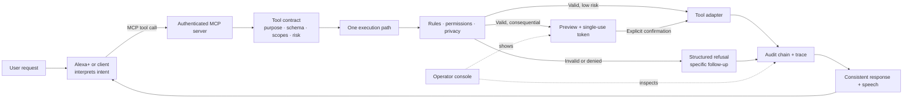

# Alexa 3.5: Safer Actions for Voice Assistants

**Pitch length: about 3 minutes**

## The Pitch

Voice assistants make everyday tasks effortless, but the same convenience becomes risky when an assistant can book, buy, change, or delete something. A language model is good at understanding what someone means; it should not be the only thing deciding whether an action is valid, authorized, or safe to execute.

Alexa 3.5 adds a deterministic action and safety layer behind Alexa+. Alexa+ interprets the request and selects a tool. Our MCP server checks permissions, validates values against explicit rules, enforces privacy settings, and then executes the action through an adapter. Low-risk actions can proceed immediately. Consequential actions return a clear preview and wait for explicit confirmation.

Every decision is visible and accountable. The server records actions and refusals in a tamper-evident, hash-chained audit log, shows tool activity in a trace, and supports undo for reversible actions. If a request is out of bounds, it is refused with a specific explanation instead of being guessed into success.

## Comparison

| | Alexa+ conversation experience | Alexa 3.5 action layer |
|---|---|---|
| Understands natural speech and manages the customer experience | Yes; Alexa+ owns the conversation and confirmation presentation | The server does not replace this. The assistant is a bounded command parser. |
| Chooses and executes actions | Selects tools and provides the user-facing experience | Validates and executes authorized MCP tool calls through one rules-controlled path |
| Risk controls | Provided by the Alexa+ experience and its integrations | Explicit scopes, parameter rules, previews, single-use confirmation tokens, and privacy gates |
| Accountability | Product-level experience | Trace plus append-only, hash-chained audit records; undo where supported |
| Integrations in this build | Alexa+ is the intended MCP client | Adapters are simulated; real device and service integrations are follow-up work |

**In short:** Alexa 3.5 is designed to complement Alexa+, not replace its voice interface or conversation intelligence. The current web app adds browser dictation and spoken replies, but it is not a full-duplex speech-to-speech system.

## Design System

**Why the MCP tools are effective:** MCP gives the assistant a structured, discoverable way to call capabilities instead of asking it to invent integrations. Each tool has a focused purpose and declares its inputs, permissions, risk, reversibility, and retry hints. Descriptions help the client choose the right tool; versioned YAML rules define acceptable values; and the server checks every call before an adapter can change state. This division keeps the language model useful for interpretation while keeping execution deterministic, fast, testable, and independent of model availability.

The risk-aware path avoids unnecessary friction: low-risk validated calls execute directly, while consequential calls pause for an explicit confirmation tied to the exact parameters. Successes and refusals return a consistent speech and error contract, with trace and audit evidence; reversible actions can be undone through a separately authorized action. YAML journeys test these paths as repeatable scenarios.

The operator console is built with React and TypeScript and uses an Amazon-inspired palette with reusable design tokens. Its Talk, Trace, Audit, Privacy, and Journeys surfaces make the system operable and inspectable. It is a developer/operator interface, not a replacement for Alexa+'s customer UI.

## Impact

The goal is to make voice-driven actions more predictable, reviewable, and recoverable:

- Prevent invalid or unauthorized changes before an adapter runs.
- Make consequential actions understandable before they happen.
- Give developers and reviewers evidence of what was requested, decided, and executed without putting raw request parameters in traces.
- Provide a consistent MCP pattern for permissions, validation, confirmations, privacy, audit, and undo.

These are design goals, not measured production outcomes. The current build is a hackathon prototype with simulated state and adapters; the next impact step is integrating real services and evaluating the complete Alexa+ flow.

## Optional Closing Sequence

“Set a ten-minute timer” shows a validated low-risk action. A thermostat value outside the allowed range demonstrates a deterministic refusal. A room booking demonstrates preview, explicit confirmation, and an audit entry. Finally, undo shows how a reversible action can be compensated and linked to its original record.