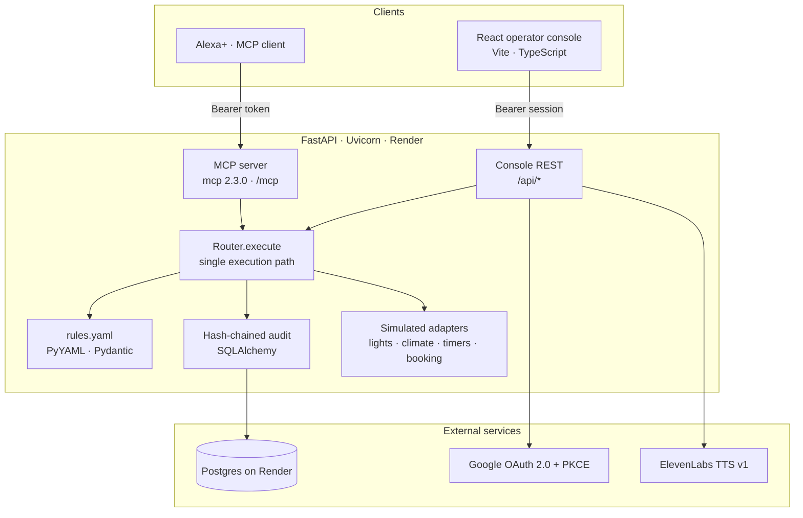
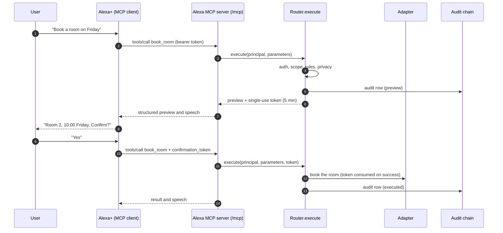
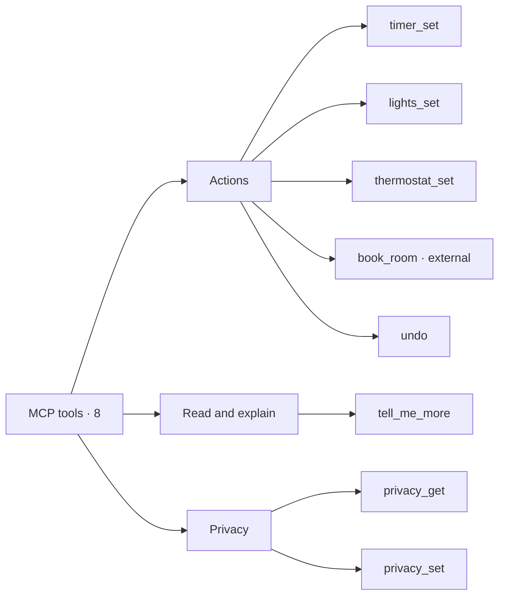

# Alexa 3.5

[](https://m8ven.ai/mcp/lil-mast-alexa3-5-1shtqv?s=readme)

**A deterministic rules and audit layer for Alexa+ agents.**

Alexa is a self-hosted MCP server that lets Alexa+ control real things (timers, alarms, lights, thermostats, media) and take consequential actions (bookings, payments, deletions) without letting the language model touch device state directly. The model interprets what the user meant. Rules decide what happens. Every action is previewed, confirmed when risky, logged, and reversible where possible.

<p align="center">
  
</p>

## Hackathon requirements

| Requirement | Status | Evidence in this repo |
|---|---|---|
| Alexa+ | Partial | Alexa+ is the MCP client. The server serves `/mcp` (`backend/app/main.py`, `backend/app/mcp_server.py`) and publishes RFC 9728 metadata. No code imports an Alexa+ SDK. Registration is done in the Alexa+ developer console, and the device test is still pending. |
| Bee | Not integrated | No code, import, or config in this repo references Bee yet. |
| Ring | Not integrated | No code, import, or config in this repo references Ring yet. The lights and climate adapters are simulated. |

Bee and Ring are not wired in. Do not describe them as working until a module imports them and a test exercises that path.

## Tech stack



| Layer | Technology and version | Where the code uses it |
|---|---|---|
| API server | FastAPI 0.150.0, Uvicorn 0.54.0 | `backend/app/main.py`, `backend/app/api/*.py`, `backend/Dockerfile` |
| MCP server | `mcp` Python SDK 2.3.0 (`MCPServer`, `TokenVerifier`) | `backend/app/mcp_server.py`, `backend/app/auth.py`, `backend/app/main.py` |
| Models and config | Pydantic 2.14.1, pydantic-settings 2.16.0 | `backend/app/models.py`, `backend/app/config.py`, `backend/app/tools/specs.py` |
| Rules | PyYAML 6.0.3 | `backend/app/rules/engine.py` loads `backend/app/rules/rules.yaml` |
| Persistence | SQLAlchemy 2.x, psycopg 3.x | `backend/app/accounts/store.py`, `backend/app/config.py` |
| Outbound HTTP | httpx2 2.15.1 | `backend/app/voice/elevenlabs.py`, `backend/app/accounts/google.py` |
| Voice | ElevenLabs text to speech, API v1 | `backend/app/voice/elevenlabs.py`, `backend/app/api/voice.py` |
| Sign-in | Google OAuth 2.0 with PKCE | `backend/app/accounts/google.py`, `backend/app/api/auth.py` |
| Console | React 19.2.7, TypeScript 5.9.3, Vite 7.3.7 | `src/`, `vite.config.ts`, `package.json` |
| Tooling | uv (backend), pnpm (frontend), ruff, pytest 9.1.1 | `backend/pyproject.toml`, `package.json`, `backend/tests/` |
| Hosting | Render (API and Postgres), Vercel (console) | `render.yaml`, `vercel.json`, `docs/DEPLOY.md` |
| CI and guards | GitHub Actions, leak scanner | `.github/workflows/ci.yml`, `scripts/check_leaks.py`, `.githooks/pre-commit` |

## How MCP is used

Alexa+ is the MCP client. Alexa 3.5 is the MCP server, and it is the only place that decides whether a state change happens.

- **Transport:** Streamable HTTP at `/mcp`, mounted on the FastAPI app in `backend/app/main.py`.
- **Auth:** A bearer token is checked by a `TokenVerifier` before any tool runs. A missing or bad token gets a 401 with a `WWW-Authenticate` header that points to `/.well-known/oauth-protected-resource/mcp`.
- **Tools:** Eight tools, each registered with `@mcp.tool` in `backend/app/mcp_server.py`. Each handler is a thin wrapper that calls `Router.execute`.
- **Annotations:** `readOnlyHint`, `destructiveHint`, and `idempotentHint` come from the same `ToolSpec` the console reads, so the two cannot drift.
- **Instructions:** The server sends one set of instructions at `initialize`, telling Alexa+ to use one tool per request and to read `detail_available` and `speech`.
- **Confirmations:** A confirmation token travels as a tool parameter (`confirmation_token` on `book_room`), not as a separate step the model must remember.
- **Primitives:** Tools only. No MCP resources or prompts are published. Read access comes through tools such as `privacy_get` and `tell_me_more`.



## Tools and outline

| Tool | Service | Risk | Scopes | Reversible | Undo target | Source |
|---|---|---|---|---|---|---|
| `timer_set` | timers | low | `home:timers:write` | yes | `timer_cancel` | `backend/app/tools/timers.py` |
| `lights_set` | lights | low | `home:lights:write` | yes | `lights_restore` | `backend/app/tools/lights.py` |
| `thermostat_set` | climate | low | `home:climate:write` | yes | `thermostat_restore` | `backend/app/tools/thermostat.py` |
| `book_room` | booking | medium | `booking:rooms:write` | yes | `booking_cancel` | `backend/app/tools/booking.py` |
| `undo` | undo | low | none | no | n/a | `backend/app/tools/undo.py` |
| `tell_me_more` | details | low | none | read only | n/a | `backend/app/tools/details.py` |
| `privacy_get` | privacy | low | `privacy:settings:write` | read only | n/a | `backend/app/tools/privacy.py` |
| `privacy_set` | privacy | low | `privacy:settings:write` | yes | n/a | `backend/app/tools/privacy.py` |

`book_room` is the only tool marked `external`, so the privacy gate refuses it when third-party sharing is off.



## The problem

Voice assistants fail in two opposite ways. Simple commands become unreliable when a model is asked to do work a rule should do: a timer set to "ten minutes" should be exactly ten minutes every time. Consequential actions become unsafe when a misheard word triggers a purchase or deletes something with no record of who or what caused it.

Alexa separates those two concerns. The LLM handles ambiguity in language. Deterministic code handles state changes.

## What it does

> The build is in progress. The status section below says what runs today. The
> deterministic assistant, the ElevenLabs voice proxy, the console REST API,
> and four YAML journeys are in the backend. The four console screens and the live
> deployment are next. The paragraphs in this section describe the target
> product, not the current binary.

**Deterministic actions.** Timers, alarms, lighting, thermostats, and media controls run through a rules engine. The model picks a tool and parameters. The engine validates them against explicit bounds (for example, thermostat setpoints between 16 and 28 °C) and applies the change. The same input always produces the same result.

**Confirmations before consequential actions.** Every tool declares a risk tier. Low-risk actions run immediately. Medium and high-risk actions return a structured preview naming the service, the tool, the exact parameters, and the expected effect. The server issues a single-use confirmation token that expires after five minutes. Nothing executes until a second call presents that token.

**Concise mode.** Responses default to terse, one-sentence answers. A
`detail_available` flag says a longer explanation exists, and Alexa+ offers it as
a follow-up ("want the details?"). A `tell_me_more` tool returns the withheld
text. Turning concise mode off puts `detail` back in every response.

**Rollback and audit.** Every tool call is written to an append-only log with a
hash chain, so tampering is detectable. Each entry records the tool name, the
caller's scope, the rules version, the parameter hash, the result, and the
compensating action if one exists. Reversible actions (lights, thermostat,
timers, bookings) expose `undo`. Irreversible actions (deletions, payments) are
marked as such before confirmation.

**Visible tool use.** Each response includes a trace of the tools called, which service each one touched, and whether it succeeded. The Alexa console shows the same trace so developers and reviewers can see exactly what happened.

**Privacy controls.** Four toggles, each stored per user and enforced by the server, not by convention: retention (how long audit entries and transcripts are kept), personalization (whether preferences are used), microphone behavior (wake-word only versus continuous, passed through as a declared requirement), and third-party sharing (whether tool results may leave the household's services).

**Developer standard.** Alexa ships as a reference implementation of an MCP developer standard: permission scopes per tool, a shared error taxonomy, simulated user journeys for testing, and a certification checklist that high-risk tools must pass before submission. See [STANDARD.md](docs/STANDARD.md).

## Quick start

```bash
# Backend
cd backend
uv sync --dev
uv run uvicorn app.main:app --reload --port 8000
```

A plain virtualenv works too:

```bash
cd backend
python -m venv .venv && source .venv/bin/activate
pip install -r requirements.txt
uvicorn app.main:app --reload --port 8000
```

The frontend sits at the repository root. With the backend still running, from
the repository root:

```bash
pnpm install
pnpm dev            # http://localhost:5173/, console at #/console/
```

The public app is at `/`; the operator console is the `#/console/` hash route.
The dev server proxies `/api` and `/health` to port 8000, so the browser keeps
one origin. Paste the development token into the console token bar, or copy
`.env.example` to `.env.local` for the session. In production, Vercel builds the
app with `VITE_API_BASE=https://alexa-api.onrender.com`; no rewrite is needed
because every screen is a hash route.

The MCP endpoint is served at `http://localhost:8000/mcp`. Inspect it with the
Alexa+ Local Inspector or the MCP Inspector before connecting it to Alexa+. The
development bearer token is `dev-token`; see [backend/README.md](backend/README.md)
for auth, endpoints, and configuration.

### Browser sign-in

The console can also sign in with Google. Copy `backend/.env.example` to
`backend/.env`, then set `ALEXA_GOOGLE_CLIENT_ID` and
`ALEXA_GOOGLE_CLIENT_SECRET` from a Google Cloud OAuth client. Register both
callbacks in that client:

```text
http://localhost:8000/api/auth/callback/google
https://alexa-api.onrender.com/api/auth/callback/google
```

Local accounts use `sqlite:///./data/alexa.db`; production uses the
`DATABASE_URL` Render injects for Postgres. The browser gets an opaque session
token after a one-time exchange code, never a Google token. Without a Google
client, use `dev-token` or set `ALEXA_AUTH_DEV_LOGIN=true` and call
`POST /api/auth/dev-login` from a local origin.

## Local CLI

`uv run python -m app.cli` is a thin MCP client for manual checks. It does not choose
tools or write speech; it sends exactly the call you type and prints the
structured result.

```bash
cd backend
uv run python -m app.cli tools
uv run python -m app.cli call timer_set '{"duration_seconds": 600, "label": "pasta"}'
uv run python -m app.cli call book_room '{"date": "2026-10-23", "guests": 4}'
uv run python -m app.cli call undo '{}'
uv run python -m app.cli bench --n 100
uv run python -m app.cli audit verify
```

Set `ALEXA_MCP_URL` and `ALEXA_TOKEN` to point at a deployed instance. A tool
business error exits non-zero, so the command is usable in a script.

## Walkthrough script (three minutes, target for Day 4)

1. Ask Alexa+ to set a ten-minute timer. It runs immediately. Show the audit entry.
2. Ask it to dim the living room lights to 30 percent. Show the rule that validated the value.
3. Ask it to set the thermostat to 35 degrees. The rules engine rejects it with a structured error, and Alexa+ asks a specific follow-up.
4. Ask it to book a room for Friday. The preview appears, naming the booking service and tool. Confirm, and show the token being consumed.
5. Say "undo that." Show the compensating action and the new audit entry linked to the original.
6. Show the privacy panel. Turn off third-party sharing and repeat step 4 to show the tool is refused.

## Product feedback

Each item names the tool, API, or SDK and the specific friction we hit. Items marked **to verify** are concerns we have not confirmed in a live device test yet.

Full submission text, with friction log and feature requests: [docs/FEEDBACK.md](docs/FEEDBACK.md).

### Alexa+ (MCP client registration and tool calling)

- **Registration metadata:** Confirm whether RFC 9728 protected-resource metadata alone is enough to register `https://<service>/mcp`, or whether Alexa+ also needs an RFC 8414 authorization-server document. We publish only the first, so this is the current device-test blocker.
- **Preview handling for `book_room`:** The two-step flow depends on the model passing `confirmation_token` back unchanged. Ask whether Alexa+ can read the structured `status: "preview"` response and show the preview itself, instead of relying on the model to paraphrase it.
- **Annotation hints:** We set `readOnlyHint`, `idempotentHint`, and `destructiveHint` on every tool. Tell us which hints Alexa+ reads, so we know whether they change behavior.
- **Tool selection testing:** **To verify:** Is there a way to test tool selection with the Alexa+ Local Inspector before a device run?

### MCP Python SDK, `mcp` 2.3.0 (`MCPServer`, `TokenVerifier`, `streamable_http_app`)

- **Accept header:** `initialize` returns 400 or 406 unless the client sends `Accept: application/json, text/event-stream`. Many clients report this as a generic connection failure. Put the header requirement in the error text.
- **Mount redirect:** Mounting the MCP app at `/mcp` with an inner route of `/` returned a 307 to `/mcp/`, which the streamable client does not follow. We mount at `/` as a workaround (`backend/app/main.py`). Document the supported mount pattern.
- **Host allow list:** `TransportSecuritySettings` answers a disallowed `Host` with 421. Clients show that as a connection failure. Return the reason in the body.

### FastAPI 0.150.0 and Starlette (`app.mount`, route order)

- **Silent route shadowing:** `/health`, `/api`, `/docs`, and the metadata route must be registered before the catch-all `app.mount("/", ...)`, or they are swallowed without an error. Warn about this in the mount documentation.

### Google OAuth 2.0 (sign-in, PKCE, `backend/app/accounts/google.py`)

- **Exact callback match:** Each environment needs its own registered callback URL. Localhost and the Render origin both have to be listed in the same OAuth client. Document that a mismatch returns a generic error page.

### ElevenLabs text to speech, API v1 (`backend/app/voice/elevenlabs.py`)

- **Privacy:** Synthesis sends the speech text to ElevenLabs. We gate it on `third_party_sharing`. **To verify:** whether the API returns rate-limit headers we can surface in the console.

### SQLAlchemy 2.x and psycopg 3.x (`backend/app/accounts/store.py`)

- **Connection scheme:** Render provides `postgres://` URLs, which SQLAlchemy does not accept for psycopg. We rewrite them to `postgresql+psycopg://` in code. Accept the `postgres://` alias, or document the rewrite in the SQLAlchemy URL guide.

### Render (API and Postgres, `render.yaml`)

- **Free instances spin down:** A spin-down clears in-memory state (house, trace, audit chain, pending confirmations). The seeded audit fixture makes the reset visible. Document a supported way to keep a small amount of state across restarts.

### Vercel (console hosting, `vercel.json`)

- **Build-time API origin:** `VITE_API_BASE` is compiled into the bundle, so changing the Render origin requires a rebuild. Document the preview-environment behavior for build-time variables.

### Toolchain: uv, pnpm, Vite 7, React 19, Mermaid

- **uv:** `uv export --frozen` generates `backend/requirements.txt`, and CI checks it against `uv.lock`. No issues beyond the export step.
- **pnpm, Vite 7, React 19:** The console builds and type checks clean. No issues observed.
- **Mermaid:** Renders natively on GitHub. No issues observed.

## License

Released under the [MIT License](LICENSE). Copyright (c) 2026 Taz.

## Scope

**In scope:** the MCP server, the rules engine, confirmations, the audit log,
concise mode, privacy enforcement, the console UI, the developer standard
documents, and a test harness with simulated journeys.

**Out of scope:** real device integrations beyond simulators, the visual
rendering of confirmations (owned by Alexa+), and the legacy Alexa skill
migration (owned by Alexa+).

## Connect from Alexa+

The server is an MCP resource server. Registration needs a public HTTPS origin
and a bearer token.

The step-by-step deployment for Render and Vercel is in `docs/DEPLOY.md`.

1. Deploy the API container to Render. Set `ALEXA_PUBLIC_URL` to the API
   origin, for example `https://alexa-api.onrender.com`, and set
   `ALEXA_ALLOWED_HOSTS` to the hostname without the scheme. The console is a
   separate static build on Vercel and calls the API across CORS.
2. Replace `ALEXA_TOKENS_JSON` with a real token table. Use a pseudonym for the
   `subject`; a raw `amzn1.` id is refused at startup.
3. In the Alexa+ developer console, register the MCP server URL
   `https://<service>/mcp` with `Authorization: Bearer <token>`.
4. Verify with `uv run python -m app.cli --url https://<service>/mcp tools` that all
   eight tools and their output schemas are visible.
5. Ask for a low-risk action, then a booking preview and confirmation.

Current limitation: the server publishes RFC 9728 protected-resource metadata
but does not run an OAuth 2.1 authorization server for MCP clients. Browser
sign-in is Google OAuth and is separate from that flow. If Alexa+ registration
requires an authorization-server metadata document, add one before the device
test. See [TROUBLESHOOTING.md](docs/TROUBLESHOOTING.md) for the failure modes we
have already hit.

## Security and privacy

- **Tokens are capabilities.** Every token maps to a subject and a scope set.
  Treat a token like a password: it belongs in `.env` or a secret manager, never
  in a tracked file, a URL, or a log line.
- **The development token is public.** `dev-token` exists so a fresh clone can
  use the inspector. A public deployment must replace `ALEXA_TOKENS_JSON`.
  Startup logs a warning when it is still the shipped value.
- **Subjects are pseudonymous.** The token table takes a stable household or
  user pseudonym. A raw `amzn1.` id fails at startup, so it cannot spread into
  device state, traces, and the future audit chain.
- **Raw parameters stay out of the trace and the audit row.** The console sees a
  parameter hash, the tool, the decision, and the speech. The audit row adds the
  minimal previous device state that undo needs, and nothing the user typed.
- **Durability is split on purpose.** Accounts and sessions live in SQLite
  locally and Postgres on Render, so a redeploy does not sign everyone out. The
  simulated house, trace, audit chain, privacy settings, and pending
  confirmations stay in memory. A restart clears them, and a pending
  confirmation becomes invalid. The seeded audit fixture makes the reset visible
  rather than silent.
- **Browser sessions are hashed at rest.** The `sess_...` bearer is stored in
  `sessionStorage`, never `localStorage` or a URL. The database keeps only its
  SHA-256 hash, plus hashes of OAuth states and exchange codes. Identity is
  Google's stable `sub`, not the email, and an unverified email is refused.
  This server sends no email and stores no password.
- **Retention is real.** Changing `retention_days` immediately replaces older
  rows for that user with tombstones that keep the chain link.
- **Booking is external.** `book_room` is marked `external=true`, so the privacy
  gate refuses it, and cancelling one, when third-party sharing is off.
- **Tool descriptions are trusted prompt text.** They are sent to Alexa+ to help
  it choose a tool. Review a change to a description as carefully as a change to
  a handler, and only expose tools whose behavior you control.
- **The image runs unprivileged.** The container uses UID 10001 and needs no
  writable volume. Render terminates TLS and adds the forwarded headers.
- **Leak scanning is enforced.** `scripts/check_leaks.py` refuses a commit that
  carries a deployment URL, an AWS account id, an Alexa skill id, a key, or an
  environment file. Enable the hook with `git config core.hooksPath .githooks`.

## Checks

```bash
cd backend
uv run ruff check .
uv run ruff format --check .
uv run pytest -q

cd ..
python3 scripts/check_leaks.py --self-test
python3 scripts/check_leaks.py --all
```

The test suite starts a real uvicorn server for the MCP round trip. It covers
auth, the 401 challenge, metadata, rules, defaults, confirmation tokens, replay,
expiry, cross-user use, booking conflicts, per-user isolation, the `NO_CHANGE`
path, tool annotations, the CLI, the audit chain including tampering and
retention tombstones, undo for every reversible tool, concise mode, privacy
isolation, Google state and PKCE, exchange replay, session expiry and logout,
server-side CORS preflight, account persistence across a new app instance, and a
latency guard on the in-memory hot path.
CI runs the same checks, verifies that `requirements.txt` matches `uv.lock`, and
builds the Docker image with a live `/health` check.

## Status

Hackathon build. Days 1 to 4 are complete: eight tools, versioned YAML rules,
single-use confirmation tokens, a hash-chained audit log with a seeded startup
fixture, `audit verify`, undo linked through the log, concise mode with
`tell_me_more`, server-enforced privacy toggles, simulated adapters, a trace
buffer, a deterministic assistant, an optional ElevenLabs voice proxy, the
console REST surface, and four YAML journeys. Google sign-in, persistent accounts
and sessions, single-use exchange codes, explicit CORS for Vercel, and Render
Postgres are in the backend; the suite is at 207 tests. The frontend is at the
repository root: pnpm, React 19, TypeScript, Vite, a warm editorial landing page,
the Amazon-themed operator console, a typed API client, and a health probe.
The sign-in, callback, and account screens are next. See
[BUILD_LOG.md](docs/BUILD_LOG.md) for what is implemented and verified,
[DECISIONS.md](docs/DECISIONS.md) for the choices and their revisit conditions,
[FRONTEND.md](docs/FRONTEND.md) for the console design, and
`docs/TECHNICAL.md` for architecture and contracts. `docs/AGENTS.md` is the
short working guide for a new contributor or coding agent.