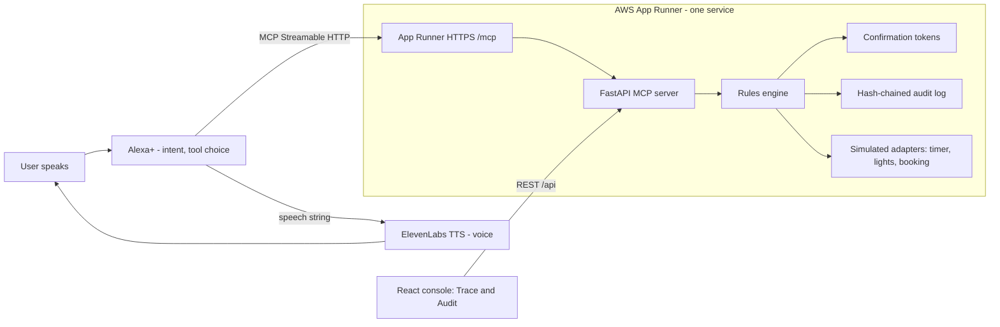
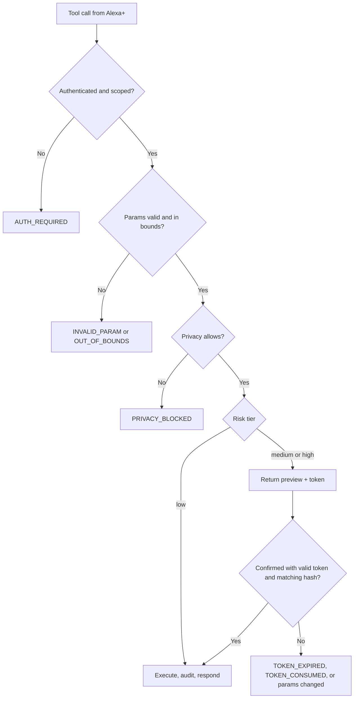

# Alexa 3.5: 4-Day Build Plan (Revised)

**Goal:** Ship a deterministic rules-and-audit MCP server that Alexa+ calls for real. Alexa+ handles the conversation and intent. Our server decides what happens, confirms risky actions, logs everything, and supports concise mode and undo.

**Voice:** ElevenLabs provides the spoken voice, so the assistant sounds the same every time. Alexa+ still drives every tool call. ElevenLabs only speaks the `speech` string that Alexa+ returns. If the ElevenLabs path fails, we play the Alexa+ response directly. Alexa+ is never bypassed.

**AWS constraint:** One AWS service, **App Runner**, hosts the public HTTPS MCP endpoint. Nothing else touches AWS.

---

## 1. Architecture



**Division of responsibility**

- **Alexa+:** interprets speech, picks tools, handles confirmation UI, speaks the response.
- **Our server:** validates, decides, executes, confirms, logs. It never calls the model or the voice service.
- **ElevenLabs:** voice output only. Not in the decision path.

---

## 2. Request Flow



---

## 3. Confirmation Tokens

- Single-use, 300-second TTL.
- Bound to a SHA-256 hash of the canonical parameters. Any change invalidates the token.
- Consumed on first successful use. Replays return `TOKEN_CONSUMED`.
- Preview contains `service`, `tool`, `params`, `effect`, `irreversible`. Alexa+ renders it.

---

## 4. Audit Log

Append-only table with a hash chain:

```
row_hash(n) = SHA-256(canonical_json(row_fields) + row_hash(n-1))
```

Each row stores tool name, tool version, scope used, params hash, decision (`executed`, `previewed`, `refused`, `no_change`), result, and `compensator_of` for undo links. `alexa audit verify` walks the chain and reports the first broken link.

**Retention:** rows older than the user's setting are deleted, but a tombstone (id, timestamp, tool, decision) stays so the chain still verifies.

**Persistence:** App Runner containers reset on redeploy, and no other AWS storage is allowed. On startup the server seeds a known audit chain from a fixture file and records a `seeded` marker. The console shows that marker, so a reset reads as intentional, not as lost data. Production would move the log to a managed store. That's a documented follow-up, not a sprint task.

---

## 5. Concise Mode

- Every response includes `speech` (one short sentence) and optionally `detail`.
- Default: `speech` only.
- Alexa+ asks "Want the details?" when `detail` exists. A `tell_me_more` tool returns the `detail` for the last action in the session.
- A user preference `concise_mode` (default on) is stored server-side and respected by every tool.

---

## 6. Privacy Controls

Four per-user settings, enforced server-side:

- `retention_days`: 0, 7, 30, or 90.
- `personalization`: when off, stored preferences are ignored.
- `microphone_mode`: `wake_word` or `continuous`. Declared in the privacy manifest. The device enforces it, not this server.
- `third_party_sharing`: when off, tools marked `external=true` return `PRIVACY_BLOCKED`.

Every change writes an audit entry.

---

## 7. Developer Standard

Published as `STANDARD.md` in the repo:

- **Permission scopes:** `domain:resource:action`, granted per user, minimum needed per tool.
- **Error taxonomy:** `INVALID_PARAM`, `OUT_OF_BOUNDS`, `NOT_FOUND`, `AUTH_REQUIRED`, `PRIVACY_BLOCKED`, `CONFIRMATION_REQUIRED`, `TOKEN_EXPIRED`, `TOKEN_CONSUMED`, `UPSTREAM_TIMEOUT`, `UPSTREAM_ERROR`. Each code maps to the follow-up Alexa+ should give.
- **Journeys:** YAML files listing utterances, expected tool calls, expected status, and expected audit effect. Run from the terminal with `alexa journeys run`.
- **High-risk certification checklist:** preview names service and tool, token binds to params, refusal path tested, audit written for both execute and refuse, irreversibility stated, one full-flow journey passing in CI. Documented as a checklist. A runner is a stretch goal.

---

## 8. Team and Roles

- **Backend (1):** MCP server, rules, tokens, audit, privacy, journeys.
- **Frontend (1):** Trace and Audit console, voice proxy wiring.
- **Integration and walkthrough (1):** Alexa+ registration, App Runner deploy, ElevenLabs voice, walkthrough script, `STANDARD.md`.

---

## 9. Four-Day Plan

### Day 0 (prep, evening before)

- Confirm Alexa+ developer access and the `alexa-ai` CLI.
- Create the GitHub repo. Name: **Alexa**.
- Create an ElevenLabs voice ID and API key. Keep the key out of git.
- Create the App Runner service pointing at `main`.

### Day 1: Server skeleton and Alexa+ connection

**Build**

- FastAPI app with the MCP Streamable HTTP endpoint at `/mcp`, spec 2025-11-25.
- 401 with the required headers on unauthenticated calls.
- Tools: `timer_set` (low), `lights_set` (low).
- In-memory simulated adapters.
- Dockerfile, `requirements.txt`.

**Connect**

- Register the server with Alexa+.
- Confirm the Local Inspector lists and calls both tools.
- Confirm one real Alexa+ voice request reaches the server and returns a response.
- Measure round-trip time. Target under 500 ms.

**Exit:** An Alexa+ voice command sets a timer, and the server logs the call.

### Day 2: Rules, errors, confirmations

**Build**

- Rules engine with YAML bounds (e.g., thermostat 16 to 28 °C).
- Error taxonomy wired to responses.
- Confirmation tokens: single-use, 300 seconds, hash-bound.
- Booking tool (simulated, medium risk) with preview, confirm, and replay refusal.

**Exit:** An out-of-bounds request returns `OUT_OF_BOUNDS`. Booking: preview, then confirm, then replay refused. All confirmed through Alexa+ voice.

### Day 3: Audit, undo, privacy, concise mode

**Build**

- Hash-chained audit log with seeded startup fixture.
- `alexa audit verify` CLI.
- Undo for lights and timers via compensators; `tell_me_more` tool.
- Concise mode default on.
- Privacy toggles enforced. `third_party_sharing` blocks `external=true` tools.

**Exit:** `audit verify` is green. Undo logged and linked. Third-party booking refused when toggled off.

### Day 4: Console, voice, deploy, walkthrough

**Build**

- React console with two screens: **Trace** (live tool calls) and **Audit** (chain status, undo button).
- ElevenLabs voice proxy: takes Alexa+'s `speech` string and speaks it.
- `STANDARD.md` finalized.
- Journeys: three YAML journeys run from the terminal.
- Deploy final build to App Runner from `main`.

**Walkthrough rehearsal**

- Run the three-minute script end to end on the live URL.
- Have a fallback: if ElevenLabs fails, play Alexa+'s response directly.

**Exit:** Three journeys pass. Console loads. Walkthrough runs live.

---

## 10. Three-Minute Walkthrough Script

1. Say "set a ten-minute timer." Trace shows the call. Audit shows the entry.
2. Say "dim the living room lights to 30 percent." Show the rule that validated it.
3. Say "set the thermostat to 35." Rules refuse it with `OUT_OF_BOUNDS`. Alexa+ asks a specific follow-up.
4. Say "book a room for Friday." Alexa+ shows the preview. Confirm. Show the token consumed.
5. Say "undo that." Show the compensating action linked in the audit.
6. Turn off third-party sharing and repeat step 4. Show `PRIVACY_BLOCKED`.
7. Run `audit verify` in the terminal. Green.

---

## 11. Definition of Done

- [ ] Alexa+ calls the live App Runner server and gets responses.
- [ ] `timer_set`, `lights_set`, and booking work through Alexa+.
- [ ] Rules enforce bounds; error taxonomy returned.
- [ ] Confirmation tokens: single-use, 300 seconds, hash-bound, replay refused.
- [ ] Audit chain verifies; undo linked.
- [ ] Concise mode and `tell_me_more` work.
- [ ] Privacy toggles enforced server-side.
- [ ] Three journeys pass.
- [ ] Console shows Trace and Audit.
- [ ] ElevenLabs speaks Alexa+ responses in the walkthrough.
- [ ] `STANDARD.md` published.
- [ ] Walkthrough runs on the live URL.

---

## 12. Cut Order

1. Certification runner (keep as a checklist in `STANDARD.md`).
2. Console Audit screen (keep the terminal `audit verify`).
3. Booking tool (keep the preview and token logic, drop the booking adapter if needed).

**Never cut:** Alexa+ connection, rules engine, confirmations, audit log, concise mode.

---

## 13. Risks

| Risk | Mitigation |
|---|---|
| Alexa+ access or registration delayed | Day 0 check. If blocked, use the Local Inspector and say so in the walkthrough. |
| Round trip over 500 ms | No model calls in the server path; warm instance; adapter timeouts at 300 ms. |
| ElevenLabs outage or cost | Fallback to Alexa+'s own audio. Cache common phrases. |
| Audit log resets on redeploy | Seeded fixture with visible `seeded` marker; documented as a follow-up. |
| Scope creep | Cut order enforced daily. |

---

**Next step:** Day 0 tonight. Confirm Alexa+ access, create the repo, and set up the App Runner service so Day 1 starts with a live endpoint.