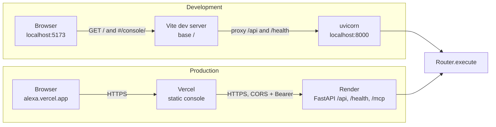
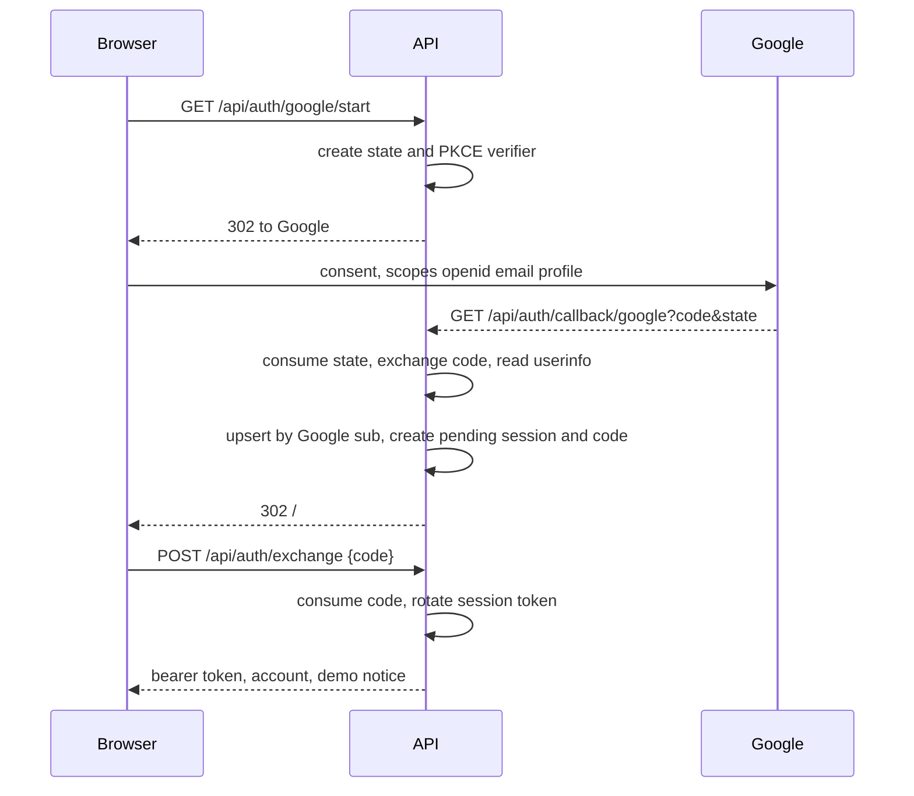
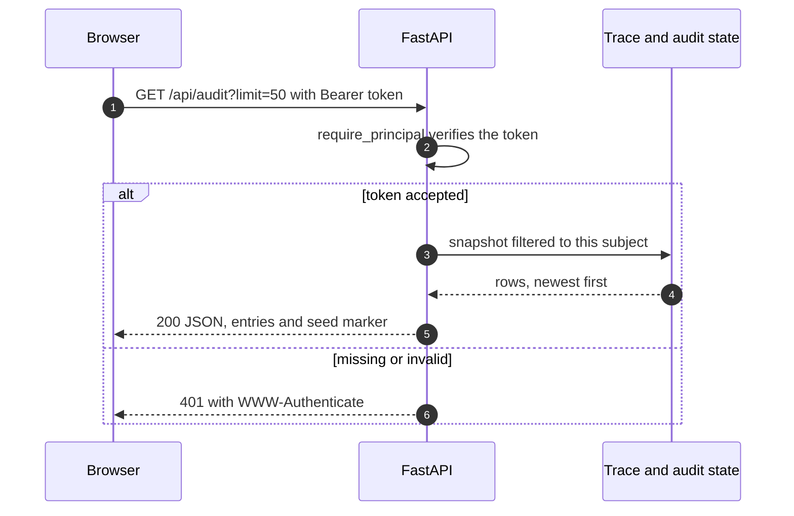
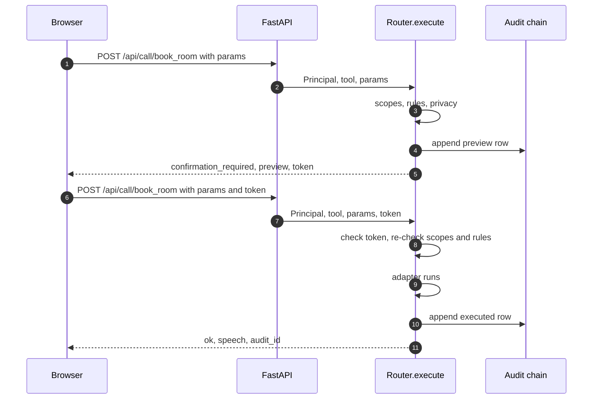
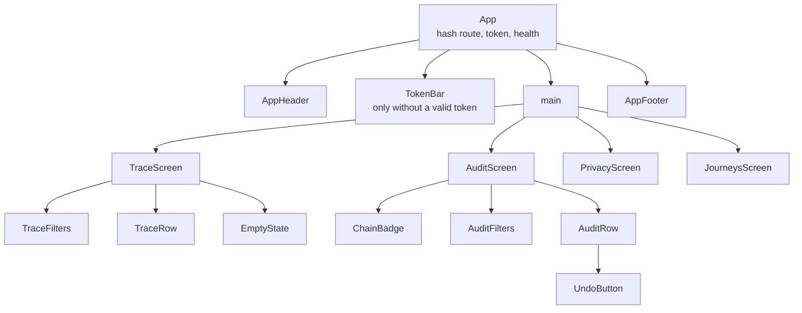

# Alexa Console: Frontend Build

The console is the operator view of the server: what Alexa+ called, what the rules
decided, and whether the audit chain still holds. It is not the customer
experience. Customers talk to Alexa+, and Alexa+ renders its own UI. This console
is for the person running the demo, debugging a refusal, or showing the audit
trail.

Status: design agreed, scaffold installed and verified. `pnpm install`,
`pnpm typecheck`, and `pnpm build` pass, and a headless browser renders the
shell against a live backend. The four screens are the next step. See the
build plan at the end of this document.

## 1. Decisions

| Area | Choice | Why |
|---|---|---|
| Location | Repository root: `index.html`, `src/`, `package.json` | Vite's root is the repository root, so the console has no nested package and one install serves the whole checkout |
| Package manager | pnpm | Lockfile is exact, installs are hard-linked, and the workspace stays small |
| pnpm settings | `pnpm-workspace.yaml` | pnpm 12 no longer reads build policy from `package.json`. Build approvals and overrides live in the workspace file, even for a single package |
| Framework | React 19 + TypeScript, built by Vite | Vite is the least opinionated way to get a typed SPA with a fast dev loop |
| Routing | Hash routing, about 20 lines, no router dependency | Four screens, no nested layouts, no server-side routes. A router would add a dependency and a second source of truth for navigation |
| Data | `fetch` plus a small polling hook | The API is read-heavy and returns newest-first lists. A query library would be reasonable later, not on day one |
| Styling | CSS custom properties plus plain CSS files | No UI kit. The theme is about 30 tokens, and a kit would fight the Amazon palette |
| Fonts | System stack, no downloaded font | Amazon Ember is proprietary and must not be bundled. The stack degrades to Segoe UI or Roboto |
| Branding | Amazon palette, no Amazon logo or smile | Visual continuity for an internal tool without implying an official Amazon product |

The backend allows both `http://localhost:5173` and `https://alexa.vercel.app`
in `ALEXA_CORS_ORIGINS`. Development normally uses the Vite proxy; the browser
still has a direct path when a screen calls the API origin explicitly.

## 2. How it runs

Development has two processes. The browser only ever talks to port 5173, and Vite
forwards `/api` and `/health` to uvicorn on 8000. That keeps the browser origin
constant and means no CORS preflight during development.

### Where it runs

The Vite app is at the repository root. In development, the browser loads `/`
from Vite, the public landing page is the root route, and the console is the
`#/console/` hash route. Every API call is proxied to uvicorn. In production,
Vercel serves the static build from the root and Render serves the API. They are
different origins, so the console sends the bearer header across CORS. The
backend can still serve `/console` from the same image as a single-origin
fallback, but that is no longer the production path.



Two hosts are deliberate now. Vercel gives the console a static CDN and an
independent release, while Render hosts the API, MCP endpoint, and Postgres. The
browser is a bearer client, not a cookie client, so `allow_credentials=False` and
the CORS allow list can stay narrow. The conditional `/console` mount remains in
the backend image for single-origin demos; the root-context Docker change is
still pending.


### Accounts and sessions

The browser account is a Google session, separate from the Alexa+ static bearer.
The landing page asks `/api/whoami` whether the stored session is still valid;
it goes to `#/demo` only after a 2xx answer, and to `#/signup` otherwise. Signup
navigates to the API start route and comes back to `/#/auth/callback`. The
callback page removes the one-time code from the hash with
`history.replaceState`, posts it to `/api/auth/exchange`, and stores the returned
bearer in `sessionStorage`. It never puts the bearer in a URL or in
`localStorage`.



Failures return to `/#/login?error=<reason>`. The stable reasons are
`email_unverified`, `invalid_state`, `oauth_denied`, `oauth_failed`,
`auth_unavailable`, and `invalid_exchange_code`. The login page reads the reason
and shows a sentence; it never renders a provider response or an exception.

The account page shows the email, display name, provider, and sign-out action.
It must also show the backend's `demo_notice` verbatim: `Demo house resets
after inactivity or redeploy. Your account and sign-in stay.` The notice is on
every auth response so the UI cannot drift from the backend.

When the API is local and `ALEXA_AUTH_DEV_LOGIN=true`, the login page may offer
`POST /api/auth/dev-login` instead of Google. It returns the same token shape and
is unavailable on a public origin.

### Reads

The screens only read. A read goes straight to the console API with the bearer
token, and the response is the server's own view of state: no decision is
recomputed in the browser.



The console renders `decision`, `status`, `error_code`, `audit_id`, and the
speech string. It never invents a field and never decides whether a call is
allowed.

### Writes

Undo calls `POST /api/call/{tool}` and the privacy toggles call
`PUT /api/privacy`. Both routes end at `Router.execute`, so scopes, rules,
privacy, confirmation, audit, and trace are the same as an MCP call. A
medium-risk action is a two-step sequence: preview, then the same call with the
token.



The console shows the preview and re-posts with the token. It does not decide
whether the token is valid, and it does not write the audit entry. A refusal is a
row too, so the audit chain explains the demo after the fact.

The console stores the operator token in `sessionStorage` and never in a
deployed build artifact. A 401 keeps the token bar on screen and prints the
server's message next to it, so the failure is diagnosable rather than a blank
screen.

## 3. Amazon theme

The palette follows Amazon's public storefront colours. The values are tokens in
`src/styles/theme.css`, and no component uses a raw hex value.

### Colour tokens

| Token | Hex | Used for |
|---|---|---|
| `--ink` | `#232F3E` | Header bar, primary dark surface |
| `--ink-2` | `#37475A` | Hover state on the header, secondary bar |
| `--ink-3` | `#4A5A6A` | Dividers on dark surfaces |
| `--orange` | `#FF9900` | Primary button fill, active tab underline, brand accent |
| `--orange-hover` | `#E88B00` | Primary button hover |
| `--blue` | `#146EB4` | Links, focus ring, informational text |
| `--blue-hover` | `#0F5A94` | Link hover |
| `--surface` | `#FFFFFF` | Cards, tables, main background of a panel |
| `--canvas` | `#F2F3F3` | Page background |
| `--border` | `#D5DBDB` | Card borders, table rules, input borders |
| `--text` | `#0F1111` | Body text |
| `--text-muted` | `#565959` | Secondary text, timestamps, labels |
| `--success` | `#067D62` | Chain ok, executed, token consumed cleanly |
| `--danger` | `#D13212` | Refusals, broken chain, errors |
| `--attention` | `#8A5A00` | Warning text and preview chips |
| `--focus` | `#146EB4` | 2 px focus ring with a 2 px offset |

Status is never carried by colour alone. Every chip has a text label, and the
chain badge has a glyph plus the word "ok" or "broken". A colour-blind operator
and a screen reader both get the state.

### Contrast

Ratios are approximate and must be re-checked with a tool before any change to the
palette. WCAG AA needs 4.5:1 for body text and 3:1 for large text and UI edges.

| Pair | Ratio | Use |
|---|---|---|
| `--text` on `--surface` | 18.9:1 | Body text |
| white on `--ink` | 13.6:1 | Header text |
| `--text-muted` on `--surface` | 7.1:1 | Secondary text |
| `--text` on `--orange` | 8.8:1 | Primary button label |
| `--orange` on `--ink` | 6.3:1 | Accent text in the header only |
| `--blue` on `--surface` | 5.4:1 | Links |
| `--success` on `--surface` | 5.1:1 | Success text |
| `--danger` on `--surface` | 5.0:1 | Error text |
| `--attention` on `--surface` | 5.9:1 | Warning text |
| `--orange` on `--surface` | 2.1:1 | Fails. Fill only, never small text |

That last row is the rule people break first. Amazon uses orange as a large fill
with dark text on top, not as coloured body text. The console does the same: a
filled primary button with `--text`, an underline, or a 3 px left rule on a card.

### Type, spacing, shape

```
font family   "Amazon Ember", -apple-system, "Segoe UI", Roboto, Helvetica, Arial, sans-serif
mono          "SFMono-Regular", Menlo, Consolas, monospace
scale         12 / 13 / 14 / 16 / 20 / 28 px, 14 px body, 1.45 line height
weights       400 body, 500 labels, 700 headings
space         4 px base: 4, 8, 12, 16, 24, 32
radius        4 px inputs and chips, 8 px cards, 999 px badges
shadow        none at rest, 0 1px 2px rgb(15 17 17 / 8%) on hover only
motion        120 ms ease-out for hover and focus, nothing else
```

`prefers-reduced-motion: reduce` removes the transition. No element animates on a
poll, so a list that refreshes every five seconds does not move under the pointer.

### Layout shell

```
┌───────────────────────────────────────────────────────────────────────────┐
│ Alexa Console   Trace  Audit  Privacy  Journeys        ● 8 tools · 3 rows │  ink #232F3E
│                     ▔▔▔▔▔                                                 │  orange underline
├───────────────────────────────────────────────────────────────────────────┤
│  Page title                                            updated 2s ago     │  canvas #F2F3F3
│  ┌─────────────────────────────────────────────────────────────────────┐  │
│  │  card: surface #FFFFFF, border #D5DBDB, radius 8                    │  │
│  └─────────────────────────────────────────────────────────────────────┘  │
└───────────────────────────────────────────────────────────────────────────┘
```

The header is 56 px, sticky. The content column is capped at 1180 px and centered.
Below 760 px the nav becomes a horizontal scroller and cards lose their side
padding. The console is desktop-first because it is used beside a demo, but it
must not break on a phone.

## 4. Component tree



State stays local to each screen. The only shared values are the token, the health
snapshot in `App`, and the selected screen. There is no global store, and no
component reads the URL except the hash route hook.

## 5. Screens

### Trace

```
┌────────────────────────────────────────────────────────────────────────────┐
│ Tool calls                                     ● live   updated 2s ago     │
│ [tool ▾] [decision ▾] [subject ▾]                          [pause]         │
├────────────────────────────────────────────────────────────────────────────┤
│ 14:32:07   lights_set      lights    executed      9 ms    a_000004        │
│            "Living room lights set to 30 percent."                         │
│            hash b37f805c…                                                  │
├────────────────────────────────────────────────────────────────────────────┤
│ 14:32:02   thermostat_set  climate   refused       3 ms    a_000003        │
│            OUT_OF_BOUNDS  "Temperature must be between 16 and 28 degrees…" │
├────────────────────────────────────────────────────────────────────────────┤
│ 14:31:55   book_room       booking   previewed     2 ms    a_000002        │
│            "Book the Oak room on Friday at 9 AM. Should I go ahead?"       │
└────────────────────────────────────────────────────────────────────────────┘
```

Rules for this screen:

- Render `speech`, not the raw parameters. The server does not send them.
- Show latency from `ms`, and the audit id as a link into the Audit screen.
- `refused` rewrites to the error code and the follow-up, because that is what a
  demo audience needs to hear.
- Newest first. A new row is inserted at the top without moving the rows the
  operator is reading.
- Pause stops polling and says so. Auto-scroll is not a feature.

### Audit

```
┌────────────────────────────────────────────────────────────────────────────┐
│ Audit                                        ┌──────────────────┐          │
│                                              │  ok   42 rows    │          │
│                                              │  head 28b292e4…  │          │
│                                              └──────────────────┘          │
│ [tool ▾] [decision ▾] [search audit id]                     [verify now]   │
├────────────────────────────────────────────────────────────────────────────┤
│ a_000013  undo          executed    14:32:19   compensator_of a_000012     │
│ a_000012  lights_set    executed    14:32:07   lights_living_room  [undo]  │
│ a_000011  privacy_set   executed    14:31:40   sharing on to off           │
│ a_000010  book_room     previewed   14:31:22   confirmation_required       │
└────────────────────────────────────────────────────────────────────────────┘
```

The chain badge is the point of the screen. It calls `/api/audit/verify` on load
and on demand, never on the polling interval, because verification walks the whole
chain. Green means `ok: true`; red shows `first_bad` and `reason` verbatim.

The undo button appears only when a row has `decision: executed`, a non-null
`compensation`, and no undo row pointing at it. That is the same rule the server
enforces, and the server remains the authority: if the console is stale, the
button returns a refusal and the console re-reads.

Retention tombstones are not returned by `/api/audit` at all, so the console does
not need a special case.

### Privacy

Four toggles and a retention select, each with one sentence about the effect:

- Third-party sharing: off refuses room booking and booking cancellation.
- Personalization: off clears the stored detail history.
- Listening: declared, enforced by the device, not by this server.
- Keep details for: 0, 7, 30, or 90 days. 0 keeps no history.

Every save is a `privacy_set` tool call, so it is validated, audited, and visible
on the Audit screen immediately. No REST shortcut writes settings directly.

### Journeys

A list of YAML journeys, a run button, and one row per step with pass or fail.
`GET /api/journeys` returns the list and `POST /api/journeys/{name}/run` runs one
against an isolated app state, so the run cannot change the live demo. The CLI
path remains available for a terminal-only rehearsal.

## 6. API contract

Current endpoints, all JSON, newest first where they return lists:

| Method | Path | Purpose | Auth | Limit |
|---|---|---|---|---|
| GET | `/health` | Status, versions, tool count, audit rows, seeded flag | none | n/a |
| GET | `/api/config` | Versions, tool count, voice availability, persistence marker | none | n/a |
| GET | `/api/whoami` | Subject, client id, scopes for the current token | bearer | n/a |
| GET | `/api/auth/config` | Google availability, start URL, frontend URL, TTL, dev login | none | n/a |
| GET | `/api/auth/google/start` | Create state and PKCE, redirect to Google | none | n/a |
| GET | `/api/auth/callback/google` | Consume state, exchange code, redirect to the SPA | none | n/a |
| POST | `/api/auth/exchange` | Trade a single-use code for a session bearer | none | code 1 to 256 |
| GET | `/api/auth/me` | Account and session expiry for the current bearer | bearer | n/a |
| PATCH | `/api/auth/me` | Change the display name on a session | bearer | name 1 to 80 |
| POST | `/api/auth/logout` | Revoke the current session | bearer | n/a |
| POST | `/api/auth/dev-login` | Local-only session without Google | none | n/a |
| GET | `/api/tools` | Manifests, field rules, rules version, confirmation TTL | bearer | n/a |
| GET | `/api/trace` | Trace entries | bearer | `limit` 1 to 200 |
| GET | `/api/audit` | The caller's audit rows plus the seed marker | bearer | `limit` 1 to 200 |
| GET | `/api/audit/verify` | Chain verdict, row count, head, first bad id | bearer | n/a |
| GET | `/api/state` | Timers, lights, climate, bookings, privacy, pending confirmation | bearer | n/a |
| GET | `/api/privacy` | The caller's privacy settings | bearer | n/a |
| PUT/PATCH | `/api/privacy` | Partial update through `privacy_set` and `Router.execute` | bearer | n/a |
| POST | `/api/call/{tool}` | Run one tool through `Router.execute` | bearer | n/a |
| POST | `/api/assistant/turn` | Deterministic parse, then `Router.execute` | bearer | utterance 1 to 500 |
| GET | `/api/assistant/session` | Pending confirmation, without the token | bearer | n/a |
| POST | `/api/assistant/confirm` | Complete the pending action | bearer | n/a |
| POST | `/api/assistant/cancel` | Drop the pending action | bearer | n/a |
| POST | `/api/assistant/reset` | Clear the pending action | bearer | n/a |
| GET | `/api/voice/config` | Whether ElevenLabs is configured and the fallback | bearer | n/a |
| POST | `/api/voice/speak` | Audio for one `speech` string | bearer | `voice_max_chars` |
| GET | `/api/journeys` | Journey list | bearer | n/a |
| POST | `/api/journeys/{name}/run` | Run one journey against isolated state | bearer | n/a |

Existing types live in `src/api/types.ts` and mirror the Pydantic models.
The new endpoint types (assistant reply, state snapshot, journey result, voice
config) still need to be added there when the screens are built. The console does
not invent fields: if a field is missing on the wire, it is missing in the type.

### The write path

The undo button and the privacy toggles need to call a tool. The journey runner
uses `POST /api/journeys/{name}/run`, which drives the same router against an
isolated state. For the direct tool writes, three options were considered:

1. **MCP from the browser.** The MCP SDK is a Node-oriented client, the streamable
   transport needs a session header and streaming, and the browser would carry a
   second copy of the tool call rules. Rejected for a four-screen console.
2. **A server-side proxy with its own token.** It would have to duplicate auth,
   scopes, and audit, or hold a second credential. Rejected.
3. **One REST endpoint that calls `Router.execute`.** The code is about 15 lines,
   the principal comes from the same bearer token, and every policy stays in one
   place. Chosen.

The endpoint is built. Its contract:

```
POST /api/call/{tool}
Authorization: Bearer <token>
{"params": {...}, "confirmation_token": "..."}   confirmation_token optional

200 -> the same ToolResponse the MCP client sees
401 -> no or invalid token
404 -> unknown tool
```

The console reads `confirmation_required`, shows the preview, and re-posts with
the token. It never re-implements the confirmation rule.

## 7. Accessibility, performance, testing

**Accessibility**

- Every control is reachable by keyboard, with a visible 2 px focus ring.
- The nav is a `nav` with `aria-current="page"` on the active screen.
- The trace list is a table, not a grid of divs, so a screen reader can navigate
  rows and columns.
- Polling does not announce. A "new calls" count is announced politely only when
  the operator has paused the list.
- Status chips pair an icon with a word. No meaning depends on hue.
- Text meets 4.5:1; the orange is fill, not prose.

**Performance**

- Budget: under 200 KB gzipped for the app bundle, no chart or icon library,
  first paint under one second locally.
- Polling every 5 seconds on a screen, every 10 seconds for the health probe, and
  only while the tab is visible. `document.hidden` pauses it, and the screen
  refreshes on return.
- Lists are capped at the server limit. No virtualization until a real need
  appears.
- Icons are inline SVG, a handful of paths, not a font.

**Testing**

- Vitest and Testing Library for the client, the hash route, the chain badge, and
  each screen's empty, loading, error, and 401 states with a mocked `fetch`.
- One Playwright smoke test against a live backend: load, see a call, open Audit,
  see the chain badge.
- The wire contract is already covered by the backend suite. The console tests
  assert rendering, not policy.

## 8. Build and deployment

From the repository root:

```bash
pnpm install
pnpm dev            # http://localhost:5173/, console at #/console/
pnpm build          # static bundle in dist/
pnpm typecheck
```

The scaffold pins exact versions of React, Vite, TypeScript, and the React types
in `package.json`, and `pnpm-lock.yaml` is generated and should be committed with
it. Vite is pinned to 7.3.7 because `@vitejs/plugin-react` 6 requires Vite 8, and
that pair was not available when the scaffold was installed. Upgrade both
together.

`pnpm-workspace.yaml` carries two things for a single package: `allowBuilds` for
esbuild, because pnpm 12 blocks install scripts by default, and four
`overrides` that pin browser data packages to the versions already in the local
store. The overrides exist because the registry was unreachable during setup.
Remove them after an online `pnpm install`, and let the lockfile record the
current versions.

Backend on port 8000 in another terminal. Paste the dev token into the token bar,
or set `VITE_CONSOLE_TOKEN` in `.env.local` at the repository root. That variable
is compiled into the bundle, so it is for local work only and `.env.local` is
ignored.

Deployment, once the screens exist:

1. `pnpm build` produces `dist/` at the repository root.
2. The image build moves to the repository root and copies `dist/` into the
   image at `/app/dist`. CI currently builds from `backend/`, so the Dockerfile
   paths (`backend/requirements.txt`, `backend/app`, `dist`) change in the same
   step.
3. FastAPI mounts it at `/console` with `StaticFiles`, before the catch-all MCP
   mount, and only when the directory exists.
4. Set `ALEXA_CORS_ORIGINS` on the API to the Vercel origin plus
   `http://localhost:5173` for local work. The console is a different origin in
   production, so the CORS preflight for `Authorization` must succeed.
5. Set `ALEXA_GOOGLE_CLIENT_ID`, `ALEXA_GOOGLE_CLIENT_SECRET`,
   `ALEXA_OAUTH_REDIRECT_URI`, `ALEXA_FRONTEND_URL`, `ALEXA_PUBLIC_URL`, and
   `DATABASE_URL` on Render. Register the production callback URI in the Google
   Cloud OAuth client.

The `/console` mount must stay conditional: a checkout without a frontend build
should still start. In the Vercel path the browser never loads that mount.

## 9. Build plan

- [x] Design doc, theme tokens, typed client, shell, health probe, token bar.
- [x] `pnpm install`, `pnpm typecheck`, `pnpm build`, and a first `pnpm dev`
      against the local backend, checked with a headless browser.
- [x] Public landing page at `/`: warm editorial layout, Alexa+ comparison,
      problem, solution flow, proof, FAQ, and a session-aware CTA that goes to
      `#/demo` only after the server validates the stored session.
- [ ] Signup, login, and the `#/auth/callback` exchange.
- [ ] Trace screen with filters, pause, and the empty state.
- [ ] Audit screen with the chain badge and the undo button.
- [ ] `POST /api/call/{tool}` plus the Privacy screen.
- [ ] Journeys screen and runner.
- [ ] `/console` static mount, Dockerfile copy, CI job, Playwright smoke.

Each step keeps the rule that the console renders decisions and never makes them.

## 10. Non-goals

- No customer-facing UI. Alexa+ owns the conversation.
- No Amazon logo, smile, or wordmark. Palette only.
- No dark mode in the demo. The token structure allows it later.
- No offline support, no service worker, no i18n.
- No direct database access and no second copy of the rules.
- No fake data in a demo path. If the server says empty, the screen says empty.

## 11. Risks

| Risk | Mitigation |
|---|---|
| Orange used as text, failing contrast | Filled buttons only; the contrast table is the review checklist |
| Console drifts from the wire contract | Types mirror the Pydantic models; backend tests own the contract |
| Token leaks into a build | Only `sessionStorage` and a dev-only env var in an ignored file |
| Second execution path grows in the console | One `POST /api/call/{tool}` endpoint that calls `Router.execute` |
| Console mount breaks MCP routing | Mount `/console` before the `/` catch-all, and only when `dist` exists |
| Polling hides a real failure | Errors replace the list with a message and the status code, never a stale list |
